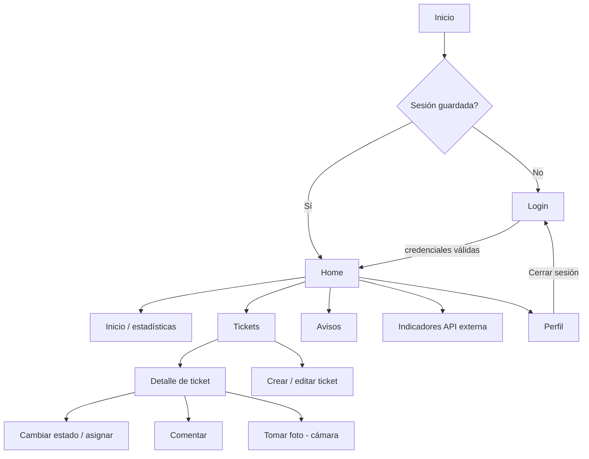
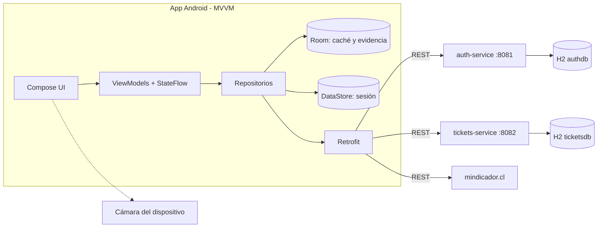

# PanalSuite — Gestión de tickets de soporte (Evaluación 3)

App móvil Android (Kotlin + Jetpack Compose) conectada a **microservicios Spring Boot** propios y a una **API externa**, con almacenamiento local y recursos nativos.

> **Integrantes:** _(completar: nombre y rol de cada integrante)_
> **Asignatura:** Desarrollo de Aplicaciones Móviles — DuocUC · **Sección:** _(completar)_

## 1. Funcionalidades

- Login con roles (Solicitante, Resolutor, Supervisor, Gerencia, Administrador); la sesión se guarda en **DataStore**.
- CRUD completo de tickets contra el microservicio (crear, listar, ver, editar, eliminar) + cambios de estado y comentarios.
- Panel con estadísticas, avisos (notificaciones) y perfil.
- **Recurso nativo:** cámara para adjuntar evidencia fotográfica (se guarda en el dispositivo, referencia en **Room**).
- **API externa** (indicadores económicos, mindicador.cl) en una pestaña separada, con otra instancia de Retrofit.
- Modo sin conexión: si el microservicio no responde se muestra la copia local (Room) con un aviso.
- Formularios validados con mensajes de error, animaciones (transiciones de navegación, `animateContentSize`), feedback háptico y snackbars.

## 2. Estructura del repositorio

```
backend/auth-service      Microservicio de usuarios y login   (puerto 8081)
backend/tickets-service   Microservicio de tickets            (puerto 8082)
mobile/                   App Android (Compose, MVVM)
mobile/keystore/          .jks ACADÉMICO para firmar el APK
docs/GIT_WORKFLOW.md      Guía de ramas y commits
```

## 3. Cómo ejecutar los microservicios

Requisitos: **JDK 17+** y **Maven 3.9+**. Cada servicio usa H2 en archivo (`./data/...`), por lo que no necesita instalar una base de datos.

```bash
cd backend/auth-service    && mvn spring-boot:run     # http://localhost:8081
cd backend/tickets-service && mvn spring-boot:run     # http://localhost:8082
```

Los datos de ejemplo se cargan solos al primer arranque. Consola H2: `http://localhost:8081/h2-console` (JDBC `jdbc:h2:file:./data/authdb`, usuario `sa`, sin clave; en tickets-service usar el puerto 8082 y `./data/ticketsdb`).

Usuarios de prueba: `solicitante`, `resolutor`, `supervisor`, `gerencia` (clave `pass123`) y `admin` (clave `admin123`).

### Endpoints — auth-service (`:8081`)

| Método | Ruta | Descripción |
|---|---|---|
| POST | `/api/auth/login` | Inicia sesión, devuelve token y usuario |
| POST | `/api/auth/register` | Registra un usuario |
| GET | `/api/auth/me` | Usuario del token |
| GET/POST | `/api/users` | Listar / crear usuarios |
| GET/PUT/DELETE | `/api/users/{id}` | Obtener / actualizar / eliminar |

### Endpoints — tickets-service (`:8082`)

| Método | Ruta | Descripción |
|---|---|---|
| GET | `/api/tickets` | Listar (filtros opcionales: `status`, `priority`, `assignedToId`, `requesterId`) |
| POST | `/api/tickets` | Crear |
| GET/PUT/DELETE | `/api/tickets/{id}` | Obtener / editar / eliminar |
| PATCH | `/api/tickets/{id}/status` | Cambiar estado / asignar |
| GET | `/api/tickets/stats` | Estadísticas |
| GET/POST | `/api/tickets/{id}/comments` | Comentarios |
| GET | `/api/notifications?userId=` | Avisos del usuario |
| PATCH | `/api/notifications/{id}/read` | Marcar como leído |

### API externa

| Método | URL | Uso |
|---|---|---|
| GET | `https://mindicador.cl/api` | UF, dólar, euro, UTM, IPC y bitcoin (pestaña **Indicadores**) |

## 4. Cómo ejecutar la app

1. Abrir la carpeta `mobile/` en **Android Studio** (Gradle JDK 17 o 21) y esperar la sincronización.
2. Levantar los dos microservicios (punto 3).
3. Emulador: las URL por defecto (`http://10.0.2.2:8081/` y `:8082`) ya apuntan al PC. En un celular físico, cambiar `authBaseUrl` y `ticketsBaseUrl` en `mobile/gradle.properties` por la IP del PC (misma red Wi-Fi).
4. Ejecutar el módulo `app`.

**Pruebas y cobertura:**

```bash
cd mobile
./gradlew :app:testDebugUnitTest        # JUnit + MockK + coroutines-test
./gradlew :app:jacocoLogicReport        # app/build/reports/jacoco/jacocoLogicReport/html/index.html
cd ../backend/auth-service && mvn test
cd ../tickets-service      && mvn test
```

La cobertura se mide sobre la lógica (repositorios, ViewModels, reglas, validadores, utilidades); la UI de Compose, el contenedor de dependencias y el código generado quedan fuera del reporte. _Revisar el porcentaje real en el reporte y adjuntar captura._

## 5. APK firmado y .jks

- Keystore académico: `mobile/keystore/panalsuite-academic.jks` (alias `panalsuite`; claves en `mobile/keystore.properties`).
- Generar el APK: `cd mobile && ./gradlew :app:assembleRelease` → `mobile/app/build/outputs/apk/release/app-release.apk`.
- Verificar la firma: `apksigner verify --print-certs app-release.apk`.

> ⚠️ El `.jks` y sus contraseñas son **de uso exclusivamente académico**. No deben usarse para publicar aplicaciones reales.

_(Pegar aquí captura del APK generado y de su verificación.)_

## 6. Diagramas

### Flujo de la aplicación



### Arquitectura



## 7. Tecnologías

| Capa | Tecnología |
|---|---|
| UI | Kotlin, Jetpack Compose, Material 3, Navigation Compose |
| Estado | ViewModel, StateFlow, corrutinas |
| Local | Room (KSP), DataStore Preferences, almacenamiento interno para fotos |
| Red | Retrofit 2 + Gson, OkHttp logging |
| Backend | Spring Boot 3.3 (Web, Data JPA, Validation), H2, BCrypt, tokens HMAC-SHA256 |
| Pruebas | JUnit 4, MockK, kotlinx-coroutines-test, JaCoCo, Spring MockMvc |

Convención: identificadores y código en inglés; textos de interfaz en español.

## 8. Flujo de trabajo Git

Ver [`docs/GIT_WORKFLOW.md`](docs/GIT_WORKFLOW.md). Cada integrante debe trabajar en su propia rama y dejar sus commits visibles en el historial.
