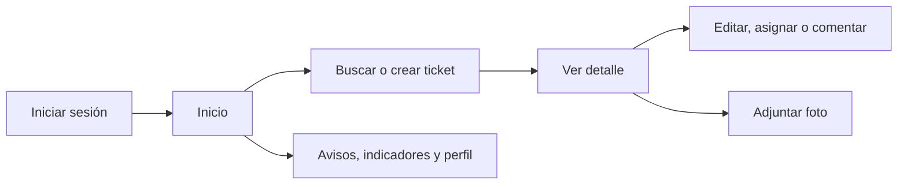
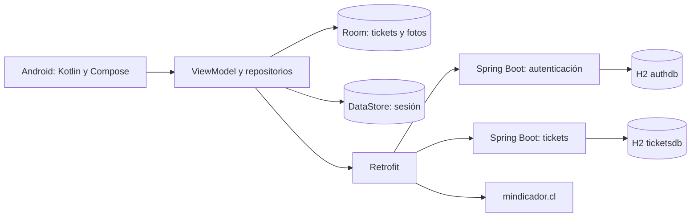

# PanalSuite

App Android para registrar, asignar y resolver tickets de soporte por sucursal.

**Integrantes:** Thomas Marin y Darliette Loncopán

**Asignatura:** Desarrollo de Aplicaciones Móviles · Duoc UC · Sección 001D

## Qué hace

- Permite iniciar sesión con distintos roles y crear, consultar, editar y eliminar tickets según los permisos.
- Permite asignar responsables, cambiar estados, comentar y adjuntar fotos con la cámara.
- Muestra estadísticas, avisos e indicadores económicos. Si se cae la conexión, muestra los tickets guardados y permite reintentar la carga.

## Cómo ejecutarlo

Necesitas JDK 17, Maven 3.9 y Android Studio con Android SDK Platform 34. Los servicios usan H2 y cargan datos de prueba al iniciar.

Abre dos terminales desde la raíz del proyecto y deja ambas abiertas.

```powershell
# Terminal 1
cd backend/auth-service
mvn spring-boot:run
```

```powershell
# Terminal 2
cd backend/tickets-service
mvn spring-boot:run
```

En Android Studio, abre la carpeta `mobile/`, espera la sincronización y ejecuta `app` en un emulador. La app usa `10.0.2.2` para conectarse al PC. Si usas un celular en la misma red, cambia `authBaseUrl` y `ticketsBaseUrl` en `mobile/gradle.properties` por la IP del PC.

**Cuentas de prueba:** `admin` con `admin123`, o `solicitante`, `resolutor`, `supervisor` y `gerencia` con `pass123`.

## Servicios y API

| Servicio | Rutas |
| --- | --- |
| Autenticación · puerto 8081 | `POST /api/auth/login`, `POST /api/auth/register`, `GET /api/auth/me`, `GET/POST /api/users`, `GET/PUT/DELETE /api/users/{id}` |
| Tickets · puerto 8082 | `GET/POST /api/tickets`, `GET/PUT/DELETE /api/tickets/{id}`, `PATCH /api/tickets/{id}/status`, `GET /api/tickets/stats`, `GET/POST /api/tickets/{id}/comments` |
| Avisos · puerto 8082 | `GET /api/notifications?userId=`, `PATCH /api/notifications/{id}/read` |
| Indicadores | `GET https://mindicador.cl/api` para la pestaña Indicadores |

## Flujo y arquitectura





## Pruebas y APK

- Desde `mobile/`, ejecuta `./gradlew.bat :app:jacocoLogicReport` para correr las pruebas Android y generar el reporte de cobertura. Para probar cada servicio, ejecuta `mvn test` en su carpeta. Las pruebas usan JUnit y MockK en Android, y JUnit y MockMvc en el backend.
- La versión empaquetada obtuvo **97,38 % de cobertura por líneas** y **81,07 % por ramas** en la lógica Android. [Informe de cobertura](entrega/evidencias/cobertura.xml).
- Desde `mobile/`, ejecuta `./gradlew.bat :app:assembleDebug` para generar el APK de prueba. Para firmar una versión de entrega, configura una llave local y sus credenciales en `mobile/keystore.properties`.

[Guía de trabajo en Git](docs/GIT_WORKFLOW.md)

## Demostración del avance 3

1. Inicia los dos servicios, abre la app e ingresa como supervisor.
2. En **Tickets**, combina una búsqueda con el estado y la prioridad. Cambia la prioridad para ver cómo acotas la lista. **Limpiar filtros** vuelve a mostrar todos los tickets disponibles para tu rol.
3. Con la lista cargada, detén el servicio de tickets y vuelve a actualizar. Repite la búsqueda y el filtro de prioridad sobre la copia local y comprueba que la app indique que está sin conexión.

## Avance 3 – Gestión de usuarios desde Android

Desde **Perfil → Gestionar usuarios**, un administrador puede buscar cuentas por nombre, usuario, correo o rol y crear una cuenta nueva. El servicio comprueba que el usuario sea único y guarda la contraseña con BCrypt.

Para mostrar el flujo, inicia ambos servicios y entra como administrador. Crea una cuenta de solicitante, búscala en el directorio, cierra sesión y entra con la cuenta nueva para registrar un ticket. El directorio de administración aparece únicamente en el perfil de administrador y el servicio también verifica ese permiso antes de modificar cuentas.

Las cuentas iniciales corresponden a un entorno académico local. Si necesitas conservar la validez de las sesiones al reiniciar el servicio de autenticación, define un valor privado para `PANALSUITE_TOKEN_SECRET` en tu entorno.
