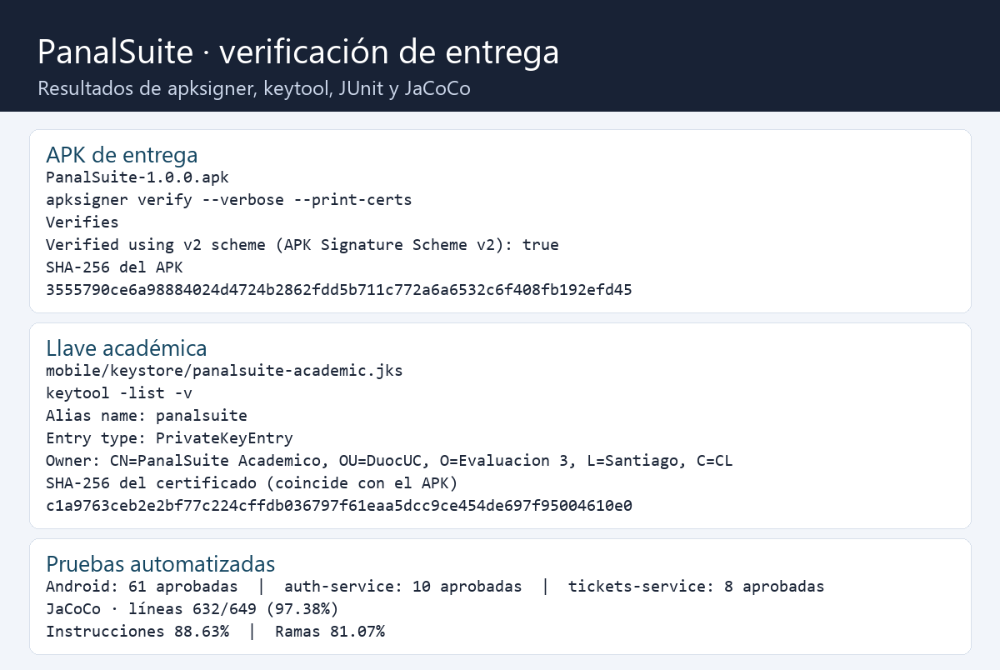
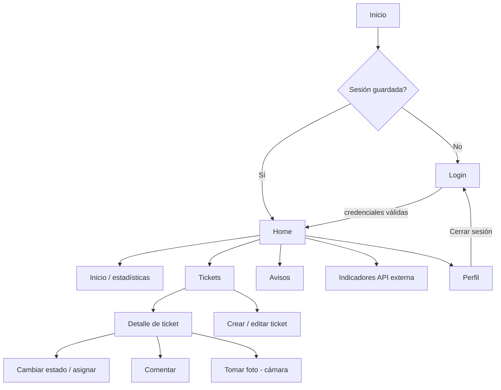
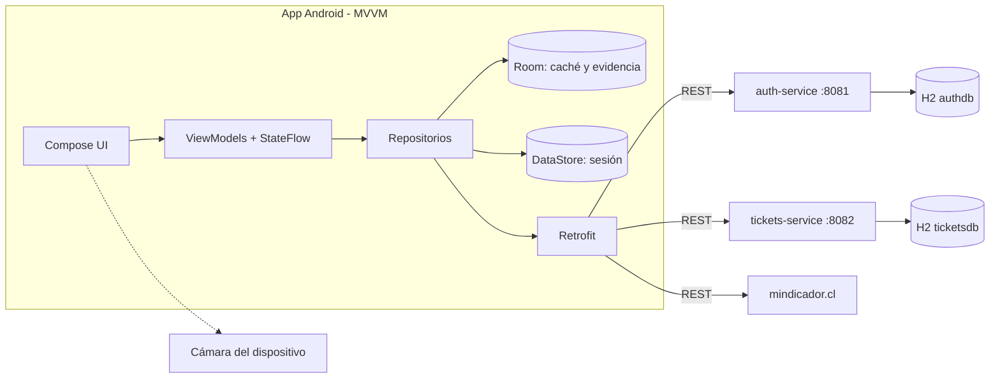
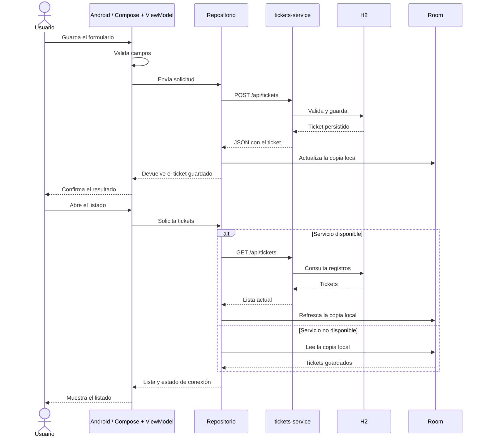

# PanalSuite — Gestión de tickets de soporte (Evaluación 3)

PanalSuite centraliza las solicitudes de soporte de una organización con varias sucursales. Los solicitantes registran incidentes, los resolutores gestionan el trabajo y los supervisores pueden asignar responsables y hacer seguimiento. La app Android se conecta a dos microservicios Spring Boot y muestra indicadores económicos en una pestaña independiente.

> **Integrantes:** _(completar: nombre y rol de cada integrante)_
> **Asignatura:** Desarrollo de Aplicaciones Móviles — DuocUC · **Sección:** _(completar)_

## 1. Funcionalidades

- Login con roles (Solicitante, Resolutor, Supervisor, Gerencia, Administrador); la sesión se guarda en **DataStore**.
- CRUD completo de tickets contra el microservicio (crear, listar, ver, editar, eliminar) + cambios de estado y comentarios.
- Panel con estadísticas, avisos (notificaciones) y perfil.
- **Recurso nativo:** cámara para adjuntar evidencia fotográfica (se guarda en el dispositivo, referencia en **Room**).
- **API externa** (indicadores económicos, mindicador.cl) en una pestaña separada, con otra instancia de Retrofit.
- Modo sin conexión: si el microservicio no responde se muestra la copia local (Room) con un aviso.
- Formularios validados con mensajes de error, animaciones (transiciones de navegación, `animateContentSize`), feedback háptico y snackbars.

## 2. Estructura del repositorio

```
backend/auth-service      Microservicio de usuarios y login   (puerto 8081)
backend/tickets-service   Microservicio de tickets            (puerto 8082)
mobile/                   App Android (Compose, MVVM)
mobile/keystore/          .jks ACADÉMICO para firmar el APK
entrega/                  APK firmado, verificación y XML de cobertura
docs/GIT_WORKFLOW.md      Guía de ramas y commits
```

## 3. Cómo ejecutar los microservicios

Requisitos: **JDK 17+** y **Maven 3.9+**. Cada servicio usa H2 en archivo (`./data/...`), por lo que no necesita instalar una base de datos.

Verifica `java -version` y `mvn -version` en PowerShell. Si presentas en Windows y `JAVA_HOME` apunta a una instalación anterior, puedes corregir la variable de la terminal con `$env:JAVA_HOME = Split-Path (Split-Path (Get-Command java).Source)`. Si PowerShell no reconoce `mvn`, agrega la carpeta `bin` de Maven al `PATH` o ejecuta `mvn.cmd` por su ruta completa.

```powershell
# Terminal 1, desde la raíz del proyecto
cd backend/auth-service
mvn spring-boot:run
```

```powershell
# Terminal 2, desde la raíz del proyecto
cd backend/tickets-service
mvn spring-boot:run
```

Mantén ambas terminales abiertas. El servicio de autenticación escucha en el puerto 8081 y el de tickets en el 8082. Los datos de ejemplo se cargan al primer arranque. Para inspeccionar H2, abre `/h2-console` en el puerto del servicio y usa `jdbc:h2:file:./data/authdb` o `jdbc:h2:file:./data/ticketsdb`, con usuario `sa` y contraseña vacía.

Usuarios de prueba: `solicitante`, `resolutor`, `supervisor`, `gerencia` (clave `pass123`) y `admin` (clave `admin123`).

### Endpoints — auth-service (`:8081`)

| Método | Ruta | Descripción |
|---|---|---|
| POST | `/api/auth/login` | Inicia sesión, devuelve token y usuario |
| POST | `/api/auth/register` | Registra un usuario |
| GET | `/api/auth/me` | Usuario del token |
| GET/POST | `/api/users` | Listar / crear usuarios |
| GET/PUT/DELETE | `/api/users/{id}` | Obtener / actualizar / eliminar |

### Endpoints — tickets-service (`:8082`)

| Método | Ruta | Descripción |
|---|---|---|
| GET | `/api/tickets` | Listar (filtros opcionales: `status`, `priority`, `assignedToId`, `requesterId`) |
| POST | `/api/tickets` | Crear |
| GET/PUT/DELETE | `/api/tickets/{id}` | Obtener / editar / eliminar |
| PATCH | `/api/tickets/{id}/status` | Cambiar estado / asignar |
| GET | `/api/tickets/stats` | Estadísticas |
| GET/POST | `/api/tickets/{id}/comments` | Comentarios |
| GET | `/api/notifications?userId=` | Avisos del usuario |
| PATCH | `/api/notifications/{id}/read` | Marcar como leído |

### API externa

| Método | URL | Uso |
|---|---|---|
| GET | `https://mindicador.cl/api` | UF, dólar, euro, UTM, IPC y bitcoin (pestaña **Indicadores**) |

## 4. Cómo ejecutar la app

1. Abrir la carpeta `mobile/` en **Android Studio**, configurar Gradle JDK 17 y confirmar que Android SDK Platform 34 está instalado. Esperar la sincronización.
2. Levantar los dos microservicios (punto 3).
3. Seleccionar un emulador Android. Las URL por defecto (`http://10.0.2.2:8081/` y `http://10.0.2.2:8082/`) apuntan al PC desde el emulador.
4. Ejecutar el módulo `app` con el botón **Run**. Para instalar el APK de entrega con el emulador abierto, ejecutar `adb install -r entrega/PanalSuite-1.0.0.apk` desde la raíz.
5. Si usas un celular físico, conecta el PC y el celular a la misma red Wi-Fi, reemplaza `authBaseUrl` y `ticketsBaseUrl` en `mobile/gradle.properties` por la IP del PC y vuelve a compilar.

Para comprobar el CRUD en la interfaz, inicia sesión con `admin`, abre **Tickets**, crea uno, ábrelo desde el listado, edítalo y elimínalo desde el detalle. Prueba la cámara desde un ticket y abre **Indicadores** con conexión a internet.

**Pruebas y cobertura:**

```powershell
cd mobile
./gradlew.bat :app:jacocoLogicReport     # Ejecuta también las pruebas Android.
cd ../backend/auth-service
mvn test
cd ../tickets-service
mvn test
```

JaCoCo mide la lógica de repositorios, ViewModels, reglas y validadores. El reporte excluye la interfaz Compose, la infraestructura de Android y el código generado. El reporte HTML se genera en `mobile/app/build/reports/jacoco/jacocoLogicReport/html/index.html`. La entrega incluye el [informe XML](entrega/evidencias/cobertura.xml).

Pasaron **61 pruebas de Android**, **10 de autenticación** y **8 de tickets**. La cobertura de la lógica Android fue **97,38 % por líneas**, **88,63 % por instrucciones** y **81,07 % por ramas**.

## 5. APK firmado y .jks

- Keystore académico: `mobile/keystore/panalsuite-academic.jks` (alias `panalsuite`; claves en `mobile/keystore.properties`).
- Generar el APK desde `mobile/` con `./gradlew.bat :app:assembleRelease` en Windows o `./gradlew :app:assembleRelease` en Linux/macOS. Gradle genera `app/build/outputs/apk/release/app-release.apk`.
- El [APK de entrega](entrega/PanalSuite-1.0.0.apk) está firmado con esa llave. Para verificarlo, ejecutar `apksigner verify --verbose --print-certs entrega/PanalSuite-1.0.0.apk` desde la raíz. `apksigner` está en `build-tools/34.0.0` del SDK.

> ⚠️ El `.jks` y sus contraseñas son **de uso exclusivamente académico**. No deben usarse para publicar aplicaciones reales.



## 6. Diagramas

### Flujo de la aplicación



### Arquitectura



### Guardado y lectura de un ticket



## 7. Tecnologías

| Capa | Tecnología |
|---|---|
| UI | Kotlin, Jetpack Compose, Material 3, Navigation Compose |
| Estado | ViewModel, StateFlow, corrutinas |
| Local | Room (KSP), DataStore Preferences, almacenamiento interno para fotos |
| Red | Retrofit 2 + Gson, OkHttp logging |
| Backend | Spring Boot 3.3 (Web, Data JPA, Validation), H2, BCrypt, tokens HMAC-SHA256 |
| Pruebas | JUnit 4, MockK, kotlinx-coroutines-test, JaCoCo, Spring MockMvc |

Convención: identificadores y código en inglés; textos de interfaz en español.

## 8. Flujo de trabajo Git

Ver [`docs/GIT_WORKFLOW.md`](docs/GIT_WORKFLOW.md). Cada integrante debe trabajar en su propia rama y dejar sus commits visibles en el historial.
